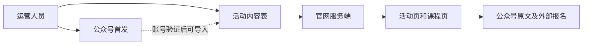

# 少年创想家官网 · 技术架构

> 状态提示：本文部分内容是未来方案，当前实际状态以 [当前交接](HANDOFF.md) 为准。无需按本文旧计划重建 Astro。

## 已实现的演示站

新版演示使用 `site/` 中的 HTML、CSS、JavaScript、GSAP/ScrollTrigger。部署产物包含一个 Cloudflare Worker，提供 `GET /api/events` 读取已发布的飞书活动，正式连接依赖团队授权。运营在飞书用户权限下录入，官网只读，家长浏览不用登录。正式音频从飞书活动记录的「语音链接」读取。独立 HTML 演示可在本地打开。详见 [活动录入与飞书接入](FEISHU.md)。

活动介绍页路由：Worker 将 `/events/<slug>/` 映射到 `event.html`，前端读取 `/api/events` 并渲染对应活动；公众号原文和报名链接位于介绍页。独立演示使用 `event-demo.html`。

## 正式站备选方案

采用 Astro 和 TypeScript。首版建议用 Astro Node standalone 按请求生成公开页面，让报名截止、活动进程和运营更新按当前时间生效。本地先接样例数据。正式环境配置团队确认的内容源和 Node 托管。站点可配置公众号读取，内容表单始终可用。

| 模块 | 职责 |
| --- | --- |
| 公共界面 | 统一布局、导航、页脚、课程概览、活动列表、详情、联系页。日期、状态和可用操作来自服务端领域逻辑 |
| 站点配置 | 中文显示名称、正式 Logo、课程简介、微信和邮箱、资源链接。可空链接直接省略 |
| 活动数据源 | `EventSource` 返回规范化记录。本地 `fixtures`。正式内容源优先采用团队已在用的工具，默认评估飞书多维表格。首版只接一个正式内容源 |
| 活动领域逻辑 | 校验、发布可见性、排序、状态、报名资格与原文链接选择。使用可注入的 `now` |
| 微信导入（P1） | 定时或手动运行在服务端，把标题、封面和原文链接写入待关联内容。用来源文章 ID 加篇序作去重键；缺可用 ID 时用规范后的原文 URL。重复执行不另起活动或覆盖手工填写的日期与报名字段 |

## 活动记录契约

| 字段 | 类型 | 规则 |
| --- | --- | --- |
| `id`, `slug`, `title` | 字符串 | `id` 和 `slug` 唯一且发布后保持不变。`slug` 使用小写字母、数字和连字符 |
| `program` | 枚举 | `day-camp`、`three-day-camp`、`online-coaching`、`other` |
| `publishState` | 枚举 | `draft`、`published`。草稿不进列表，其详情返回 404 |
| `scheduleState` | 枚举 | `scheduled`、`postponed`、`cancelled`。延期可暂缺日期，原页仍可见 |
| `startsAt`, `endsAt` | ISO 时间或空 | 录入北京时间，归一化保留时区。正常排期必须提供两项且 `endsAt > startsAt` |
| `location`, `summary` | 字符串或空 | 只展示团队确认的内容 |
| `registrationState`, `registrationClosesAt`, `registrationUrl` | 枚举、时间或空、HTTPS URL 或空 | 枚举为 `closed`、`open`、`full`，默认 `closed`。可无独立截止时间，最晚在开营时停止报名 |
| `wechatAnnouncementUrl`, `wechatRecapUrl` | HTTPS URL 或空 | 校验公众号原文域名为 `mp.weixin.qq.com`。预告与回顾分列 |
| `cover`, `works` | 媒体或空、媒体数组 | 媒体包含 `url` 和替代文字 `alt`。一个活动可公开多项作品 |

`now < startsAt` 时为即将开始，`startsAt ≤ now < endsAt` 为进行中，`now ≥ endsAt` 为已结束。延期、取消优先于日期推导。近期活动升序，往期降序，同一时间按 `id` 排序。未确定排期的延期记录保留直接访问，放在活动列表的单独提示区域。取消活动保留详情并显示取消提示。

报名展示条件为已发布、正常排期、尚未开始、显式开放、有合法网址，且未到截止时间。有独立截止时间时取其与开营时间的较早者。结束后优先显示公众号回顾，同时可保留预告入口。

## 内容读取与故障处理

- 服务端读取和校验源记录，成功结果建议每实例缓存 3 分钟，同一实例并发刷新复用请求。接口出错时保留上次成功快照，30 秒后可重试。网站继续展示快照中的课程和回顾，数据已过期且刷新失败时暂停报名按钮，防止继续用旧报名地址。无快照时活动页显示暂无可用数据；此状态下详情返回 503。已成功加载活动表、却查无匹配路径时才返回 404。
- 服务端保留运营发布所需的最小密钥权限，密钥通过部署环境配置。页面仅输出公开字段，外链使用 HTTPS，不嵌入任意 HTML。真实运营数据、联系方式和学员素材按团队确认的公开范围使用。
- 正式站保持普通 HTML 页面，微信内直接访问官网、公众号原文和原报名服务。接入正式域名前现场验证网络、部署位置和微信内访问。选定托管后再固化发布方式。

技术依据可参考 [Astro Node 适配器文档](https://docs.astro.build/en/guides/integrations-guide/node/) 和 [微信已发布消息列表接口](https://developers.weixin.qq.com/doc/subscription/api/public/api_freepublish_batchget.html)。
